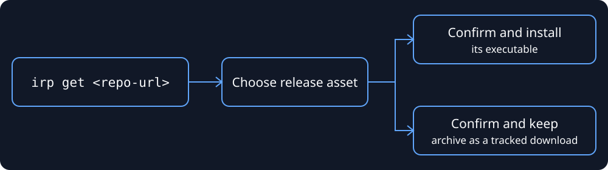

<p align="center">
  
</p>
<p align="center">
  <em>CLI to install any CLI</em>
  <br><br>
  <a href="https://shields.io/">
    
  </a>
<p>

<br>


**Install Release Plus** is a fork of [install-release](https://github.com/Rishang/install-release). The internal `InstallRelease` package and existing state/config paths are preserved to simplify upstream merges.

**Install Release Plus** gives you the `irp` command to install and keep single-binary CLI tools updated on Linux, macOS, and WSL. It works with GitHub, GitLab, and Forgejo-powered Codeberg releases, and supports mise/aqua registry entries and Docker images.

This can be any tool you want to install, which is pre-compiled for your device and present on a supported provider.


See the [quickstart](README.md#quickstart) for the current `irp` workflow.

> INFO: It's mainly for installing tools that are not directly available officially by package managers like `apt, yum, pacman, brew` etc.

<p align="center">
  
</p>

## Highlights

#### [GitHub, GitLab, and Codeberg releases](#install-tool-from-github-gitlab-and-codeberg-releases-)

`irp` is mainly built for installing CLI tools straight from GitHub, GitLab, or Codeberg releases. Codeberg support uses its Forgejo-compatible API. Give `irp` a repository URL, and it finds the right release asset for your system.

```bash
# Install from GitHub
irp get https://github.com/denoland/deno

# Install from GitLab
irp get https://gitlab.com/gitlab-org/cli -n glab

# Install from Codeberg (Forgejo)
irp get https://codeberg.org/forgejo/forgejo

# Install from a self-hosted GitLab or Forgejo instance
irp get gitlab@gitlab.example.com/group/subgroup/mytool
irp get forgejo@git.example.com/owner/mytool
```

#### [Package mode (`--pkg`)](#install-as-system-package-debrpmappimage-)

Some tools ship better as `.deb`, `.rpm`, or `AppImage` packages. Use `--pkg` when you want `irp` to install that package instead of picking a standalone binary.

```bash
# Install any package from GitHub releases
irp get https://github.com/redis/RedisInsight --pkg
```

#### Extra providers

- [mise/aqua](#install-tool-via-mise-registry-): Install tools from registry metadata.

```bash
# Install from mise/aqua registry
irp get mise@terraform
```

- [Docker](#install-docker-image-as-a-cli-tool-): Run container images like local CLIs.

```bash
# Install from Docker image (with custom name)
irp get docker@mcr.microsoft.com/azure-cli -n az
```
<!-- Table of content -->

## Table of Contents 📚

- [Table of Contents 📚](#table-of-contents-)
- [Highlights](#highlights)
- [Getting started ⚡](#getting-started)
  - [Installation](#installation)
  - [Manage your tools](#manage-your-tools)
- [Example usage `irp --help` 💡](#example-usage-irp---help-)
  - [Install completion for cli 🎠](#install-completion-for-cli-)
  - [Install tool from GitHub, GitLab, and Codeberg releases 🌈](#install-tool-from-github-gitlab-and-codeberg-releases-)
    - [Self-hosted GitLab and Forgejo instances 🏠](#self-hosted-gitlab-and-forgejo-instances-)
    - [Install as system package (deb/rpm/appimage) 📦](#install-as-system-package-debrpmappimage-)
  - [Install tool via mise registry 🧩](#install-tool-via-mise-registry-)
  - [Install Docker image as a CLI tool 🐳](#install-docker-image-as-a-cli-tool-)
  - [Download and track release assets](#download-and-track-release-assets)
  - [Install specific release asset from GitHub, GitLab, or Codeberg releases 🔦](#install-specific-release-asset-from-github-gitlab-or-codeberg-releases-)
    - [Method 1: Interactive Selection (Recommended)](#method-1-interactive-selection-recommended)
    - [Method 2: Command-line Flag](#method-2-command-line-flag)
  - [List installed tools 📋](#list-installed-tools-)
  - [Show info about an installed tool ℹ️](#show-info-about-an-installed-tool-️)
  - [Remove installed release ❌](#remove-installed-release-)
  - [Update all previously installed tools to the latest version 🕶](#update-all-previously-installed-tools-to-the-latest-version-)
    - [Update installed system packages 📦](#update-installed-system-packages-)
  - [Pull state templates for installing tools 📄](#pull-state-templates-for-installing-tools-)
  - [Hold Update to specific installed tool ✋](#hold-update-to-specific-installed-tool-)
  - [Configure tool installation path 🗂️](#configure-tool-installation-path)
  - [Configure updates for pre-release versions 🔌](#configure-updates-for-pre-release-versions-)
  - [Configure provider tokens for higher rate limits 🔑](#configure-provider-tokens-for-higher-rate-limits-)


## Getting started


### Installation

#### Option 1: Build and install this checkout

`build.sh` compiles the local source into `dist/InstallReleasePlus`. `install.sh`
checks that build and installs it at `~/bin/irp`, calling `build.sh` only when
needed. It replaces an existing executable at that path after a successful build
and smoke check. It does not download a published binary or register this local
build with a release updater.

Prerequisites on Linux/macOS/WSL:

- `uv` and a Python version supported by the project (Python 3.10 or newer).
- A C compiler (`cc`, GCC, or Clang); on macOS, install the Xcode command line tools.
- `patchelf` on Linux.
- The `libmagic` runtime library (`file-libs` on Fedora/RHEL, `libmagic` with Homebrew).
- Optional: `ccache` to speed up subsequent builds.

`build.sh` enables Nuitka's `--show-scons` output, so C compiler commands remain
visible during long builds. The compiler can still spend time on an individual
command without producing additional output. Optionally set `IRP_BUILD_JOBS`
to a positive integer to limit parallel C compiler processes; local builds
otherwise use Nuitka's default.

From your local checkout, run:

```bash
./build.sh    # Build only; always compiles
./install.sh  # Install, building first only if missing or stale
```

Both scripts work when invoked by full path from another working directory.
The build script synchronizes the locked development dependencies with `uv`,
compiles using Nuitka, and checks `dist/InstallReleasePlus --help`. It records a fingerprint in
`dist/.irp-build.json`; installation reuses the executable only when the Python
sources, build script, dependency files, platform, and binary content still match.
Added or deleted source files also trigger rebuilding. An existing executable
without a fingerprint is rebuilt once. Use `./build.sh --check` to check freshness
without compiling (exit status 0 means current; 1 means missing or stale).
Dependency setup and compiler tooling may require network access; Install Release Plus
itself is always built from this checkout, including your uncommitted changes.
Run `./install.sh` again after source changes; it rebuilds automatically when needed.

After installation, refresh command lookup in your existing Bash/Zsh terminal:

```bash
export PATH="$HOME/bin:$PATH"
hash -r
command -v irp
irp --help
```

`command -v irp` should resolve to `~/bin/irp`. The compiled artifact is also kept
at `dist/InstallReleasePlus`. A failed build or smoke check leaves the installed
binary intact. `irp me -U` installs a published release from this fork; use
`./install.sh` to update from your local checkout instead.

To run the default tests, force a fresh build, and install it:

```bash
uv sync --locked --dev
uv run --no-sync pytest -q test
uv run --no-sync ruff check .
./build.sh
./install.sh
```

The default suite is offline: it uses local fixtures, a loopback HTTP server,
private temporary state, and isolated installation directories. It blocks external
network connections in the Python tests. It does not need Docker, GitHub tokens,
a C compiler, or third-party downloads once the Python dependencies and system
`libmagic` library are installed. Loopback sockets, subprocesses, Bash, and standard
Unix utilities (`install`, `true`, etc.) must be permitted by the runner.
Git is also required for local upstream-sync regression fixtures; these use
temporary repositories and never contact GitHub.

The compiled executable has a separate opt-in check for command identity, version
metadata, and the configured fork URL:

```bash
./build.sh
uv run --no-sync pytest -q test --compiled -m compiled
```

Live Docker installation tests require external network access and are excluded
by default. Enable them explicitly:

```bash
uv run --no-sync pytest -q test --live -m live
```

The AWS CLI fixture expects a clear rejection of its shared-library bundle,
rather than a successful standalone installation. A local synthetic bundle also
tests that rejection without contacting AWS or GitHub.

For a disconnected CI runtime, prepare the test image while dependencies are
available (or import a previously prepared image), then disable networking:

```bash
docker build -f test/images/offline/Dockerfile -t irp-offline-tests .
docker run --rm --network none irp-offline-tests
docker run --rm --network none --entrypoint bash irp-offline-tests -ec '
  ./build.sh
  .venv/bin/python -m pytest -q test --compiled -m compiled
'
```

The image supplies the compiler, Nuitka, Python dependencies and system libraries.
Dependency acquisition/image preparation needs an accessible registry, mirror or
cache; it is separate from the disconnected test/build runtime. An empty,
air-gapped runner cannot install missing dependencies. The GitHub Actions test
workflow uses this same split and runs tests and compilation with `--network none`.

Tests use `IRP_STATE_DIR` to keep JSON state/configuration away from real user data.
Installer tests use `IRP_BIN_DIR` to isolate their target directory; leaving it
unset preserves the normal `~/bin/irp` destination.

After confirming `irp --help` works, remove the old tracked installation if
`irp ls` still lists `ir`. This also removes its state entry so a later upgrade
does not reinstall the upstream executable:

```bash
irp rm ir
```

Then remove any remaining legacy `ir` executables:

```bash
rm -f "$HOME/bin/ir" "$HOME/.local/bin/ir"
hash -r
type -a irp
```

The command should resolve to `~/bin/irp`. Build scripts never create an `ir`
alias or install another copy into `~/.local/bin`.


#### Option 2: Install this checkout with pip

**Prerequisites:**

- Python 3.10 or higher
- pip
- [libmagic](https://github.com/ahupp/python-magic#installation)

```bash
pip install .
```

---

**Set up the PATH for shell (e.g. ~/.bashrc or ~/.zshrc):**

Tools installed via `irp` will be installed to `~/bin` by default.

```bash
export PATH="$HOME/bin:$PATH" 
```

If you want to change the installation path, you can use the `irp config --path <path>` flag.

---

### Manage your tools

Example: Installing [deno (Rust-based JavaScript runtime)](https://github.com/denoland/deno) directly from its GitHub releases:

```bash
# Usage: irp get [GITHUB-URL or GITLAB-URL or CODEBERG-URL or gitlab@<HOST>/<OWNER>/<REPO>
#                or forgejo@<HOST>/<OWNER>/<REPO> or mise@<TOOL> or docker@<IMAGE-URI>]

# GitHub URL
❯ irp get https://github.com/denoland/deno

# mise registry
❯ irp get mise@terraform

# Docker image with latest tag
❯ irp get docker@hashicorp/terraform:latest
```

Verify the installation:

```bash
❯ which deno
~/bin/deno

❯ deno --version
deno 1.46.3 ...
```

Example: Installing [GitLab CLI](https://gitlab.com/gitlab-org/cli) with a custom binary name `glab`:

```bash
❯ irp get https://gitlab.com/gitlab-org/cli -n glab
```

Verify the installation:

```bash
❯ which glab
~/bin/glab

❯ glab --version
glab 1.80.0 ...
```

Codeberg repositories use the same install and update workflow. For example, install [Forgejo](https://codeberg.org/forgejo/forgejo) from its Codeberg releases:

```bash
❯ irp get https://codeberg.org/forgejo/forgejo
```

Once installed, you can manage your tools with these simple commands:

- **List**: `irp ls` — See all installed tools and versions.
- **Update**: `irp upgrade` — Upgrade all installed tools to their latest releases, or use `irp upgrade <name>` for a specific tool.
- **Remove**: `irp rm deno` — Remove a tool from your system.

For more details, check the [Table of Contents](#table-of-contents-).


## Example usage `irp --help` 💡

```
# Help page

❯ irp --help
Usage: irp [OPTIONS] COMMAND [ARGS]...

  GitHub / GitLab / Codeberg / Mise release installer based on your system (Linux/MacOS)

  Options:
    --install-completion   Install completion for the current shell.
    --show-completion      Show completion for the current shell, to copy it or customize the installation.
    --help                Show this message and exit.

  Commands:
    get      | Install a CLI tool or keep a release archive as a tracked download
    upgrade  | Upgrade all installed CLI tools from their repositories
    ls       | List all installed CLI tools
    info     | Show info about an installed CLI tool
    rm       | Remove any installed CLI tool
    config   | Set configs for Install Release Plus
    state    | Show the current stored state of Install Release Plus
    pull     | Install tools from the remote Install Release Plus state URL
    hold     | Keep an installed CLI tool's updates on hold.
    me       | Update the Install Release Plus tool.
```

For sub-command help use: `irp <sub-command> --help`

### Existing installations and name collisions

Before downloading a binary (including mise installs) or pulling an image for a
Docker wrapper, `irp` checks existing names and destination files. A comparison
shows the existing and proposed name, install path, source repository, release
tag, asset filename/URL/size/ID/update time, prerelease status, update hold, and
Docker options. Changed fields are marked. Metadata for untracked files is
shown as unknown.

The overwrite prompt defaults to **No**. Declining leaves files and state
unchanged. `irp get -y` explicitly approves overwrites after displaying the
comparison; it still skips a release whose tracked identity and destination
match. This compares recorded release metadata, not the executable's bytes.
Docker tags additionally require matching local and remote digests to count as
identical. Missing executables can be reinstalled. `irp upgrade --force` allows
an intentional refresh, and upgrade's existing approval applies to replacements.

Previous binary records owning an overwritten destination are removed only
after a successful installation, when the new record is saved. Symlinks and
non-regular destination files are rejected. Use `--name` for a different command
name. Archive downloads keep their file-ownership safeguards, and native package
conflicts remain the responsibility of the system package manager.

Example: `irp get --help`

#### Install completion for cli 🎠

```bash
# irp --install-completion [SHELL: bash|zsh|fish|powershell]
# Example for zsh:
irp --install-completion zsh
```

#### Install tool from GitHub, GitLab, and Codeberg releases 🌈

Use a repository URL in one of these forms:

```text
https://github.com/<owner>/<repo>
https://gitlab.com/<owner>/<repo>
https://codeberg.org/<owner>/<repo>
```

Codeberg is powered by Forgejo, so `irp` accesses Codeberg releases through the Forgejo-compatible API. Codeberg tools are recorded in `irp`'s state and can be managed with `irp ls`, `irp info`, `irp upgrade`, and `irp rm` like tools from GitHub and GitLab.

```bash
# Install Forgejo from Codeberg
❯ irp get https://codeberg.org/forgejo/forgejo
```

##### Self-hosted GitLab and Forgejo instances 🏠

Self-hosted instances are addressed with a provider prefix, which tells `irp` which API the domain speaks (https is assumed):

```text
gitlab@<host>/<owner>/<repo>
forgejo@<host>/<owner>/<repo>
```

```bash
# Self-hosted GitLab (GitLab subgroups are supported)
❯ irp get gitlab@gitlab.example.com/group/subgroup/mytool

# Self-hosted Forgejo / Gitea
❯ irp get forgejo@git.example.com/owner/mytool
```

Self-hosted tools are recorded in state under their prefixed form, so `irp ls`, `irp info`, `irp upgrade`, and `irp rm` work on them like any other tool. See [provider tokens](#configure-provider-tokens-for-higher-rate-limits-) for authenticating against a private instance.

GitHub example:

```bash
❯ irp get "https://github.com/ahmetb/kubectx"

📑 Repo     : ahmetb/kubectx
🌟 Stars    : 13295
✨ Language : Go
🔥 Title    : Faster way to switch between clusters and namespaces in kubectl

                    📦 Available Assets for kubectx
┏━━━━━━━━━━┳━━━━━━━━━━━━━━━━━━━━━━━━━━━━━━━━━━━━┳━━━━━━━━━━━┳━━━━━━━━━━━┓
┃ Asset ID ┃ Filename                           ┃ Size (MB) ┃ Downloads ┃
┡━━━━━━━━━━╇━━━━━━━━━━━━━━━━━━━━━━━━━━━━━━━━━━━━╇━━━━━━━━━━━╇━━━━━━━━━━━┩
│ 1        │ kubectx_v0.9.4_linux_x86_64.tar.gz │ 1.0       │ 43811     │
└──────────┴────────────────────────────────────┴───────────┴───────────┘

                              🚀 Install: kubectx
┏━━━━━━━━━┳━━━━━━━━━━━━━━━━━━━━━━━━━━━━━━━━━━━━┳━━━━━━━━━┳━━━━━━━━━┳━━━━━━━━━━━┓
┃ Name    ┃ Selected Item                      ┃ Version ┃ Size Mb ┃ Downloads ┃
┡━━━━━━━━━╇━━━━━━━━━━━━━━━━━━━━━━━━━━━━━━━━━━━━╇━━━━━━━━━╇━━━━━━━━━╇━━━━━━━━━━━┩
│ kubectx │ kubectx_v0.9.4_linux_x86_64.tar.gz │ v0.9.4  │ 1.0     │ 43811     │
└─────────┴────────────────────────────────────┴─────────┴─────────┴───────────┘
Install selected tool? [Y/n/ Asset ID]: y
 INFO     Downloaded: 'kubectx_v0.9.4_linux_x86_64.tar.gz' at /tmp/dn_kubectx_ph6i7dmk                                                               utils.py:159
 INFO     install /tmp/dn_kubectx_ph6i7dmk/kubectx /home/noobi/bin/kubectx                                                                  core.py:132
 INFO     Installed: kubectx
```

```
# checking if kubectx is installed
❯ which kubectx
/home/noobi/bin/kubectx

❯ kubectx --version
0.9.4
```

##### Install as system package (deb/rpm/appimage) 📦

If the release asset files provide a package file for your system, you can install tools as a system package (deb/rpm/appimage) instead of a standalone binary by using the `--pkg` flag.

This is useful for tools that provide `.deb`, `.rpm` or `appimage` releases that might need other system package dependencies to work.

```bash
# Example installation of RedisInsight, a dashboard to manage Redis
❯ irp get https://github.com/redis/RedisInsight --pkg
```

#### Install tool via mise registry 🧩

Some tools (like Terraform, Packer, etc.) don't publish platform-specific binaries on GitHub releases — they host their own download URLs instead. For these tools, `irp` can resolve the correct download URL via the [mise](https://mise.jdx.dev/) / [aqua](https://aquaproj.github.io/) registry using the `mise@` prefix.

```bash
# Usage: irp get mise@<tool-name>
❯ irp get mise@terraform

# Install a specific version (inline or via --tag)
❯ irp get mise@terraform:v1.12.0
❯ irp get mise@terraform -t v1.12.0
```

```
                     Install terraform (via mise/aqua)
┏━━━━━━━━━━━┳━━━━━━━━━━┳━━━━━━━━━━━━━━━━━━━━━━━━━━┳━━━━━━━━━━━━━━━━━━━━━━━━━━━━━━━━━━┓
┃ Tool      ┃ Version  ┃ File                     ┃ URL                              ┃
┡━━━━━━━━━━━╇━━━━━━━━━━╇━━━━━━━━━━━━━━━━━━━━━━━━━━╇━━━━━━━━━━━━━━━━━━━━━━━━━━━━━━━━━━┩
│ terraform │ v1.12.0  │ terraform_1.12.0_linu... │ https://releases.hashicorp.c...  │
└───────────┴──────────┴──────────────────────────┴──────────────────────────────────┘
Install selected tool? [Y/n]: y
```

Tools installed via `mise@` are also tracked by `irp ls` and upgraded with `irp upgrade` just like GitHub/GitLab tools.

> **Note:** The mise provider currently only supports tools with **HTTP-based** download URLs in the aqua registry. Tools that use `github_release` type assets should be installed directly via their GitHub URL (`irp get <github-url>`) instead.

#### Install Docker image as a CLI tool 🐳

`irp` can wrap any Docker image as a local CLI tool using the `docker@` prefix. It pulls the image, detects its entrypoint, and writes an executable wrapper script to `~/bin/<toolname>` that proxies all invocations through `docker run`.

```bash
# Usage: irp get docker@<image>[:<tag>]
❯ irp get docker@hashicorp/terraform

# Install a specific tag (inline or via --tag)
❯ irp get docker@hashicorp/terraform:1.7.0
❯ irp get docker@hashicorp/terraform -t 1.7.0

# Custom tool name
❯ irp get docker@mcr.microsoft.com/azure-cli -n az

# Pass extra docker run options (e.g. volume mounts, env vars)
❯ irp get docker@alpine:latest -n alpine --docker-opts "-v $HOME/data:/data"
```

```
         Install terraform (via Docker)
┏━━━━━━━━━━━┳━━━━━━━━━━━━━━━━━━━━━━━┳━━━━━━━━┓
┃ Tool      ┃ Image                 ┃ Tag    ┃
┡━━━━━━━━━━━╇━━━━━━━━━━━━━━━━━━━━━━━╇━━━━━━━━┩
│ terraform │ hashicorp/terraform   │ latest │
└───────────┴───────────────────────┴────────┘
Install selected tool? [Y/n]: y
```

- **Latest tags** (`latest`) are checked for updates via digest comparison during `irp upgrade` — only re-pulled when the remote image has changed.
- **Pinned tags** (e.g. `1.7.0`) are held from auto-upgrade; use `irp upgrade --force` to re-pull.
- The wrapper mounts the current directory into the container at `/tmp/cmd`, so the tool sees your local files.
- **Extra Docker options (`--docker-opts`)**: You can pass additional flags to `docker run` (e.g. `-v` volume mounts or `-e` environment variables) via `--docker-opts`.
  - The value is inserted into the `/bin/sh` wrapper as-is, so it's raw shell (paths with spaces must be quoted).
  - The options are persisted in state and reused on `irp upgrade`.
  - Re-running `irp get` without `--docker-opts` preserves the previously saved options. To clear them, pass an explicit empty string (`--docker-opts ""`).

### Download and track release assets

When `irp get` selects an archive (such as `.tar.gz`, `.zip`, or `.tar.xz`),
choose how to use it before downloading:

```text
Selected asset is an archive:
  1. Install its executable
  2. Keep archive as a tracked download
Archive action (1/2/n) [1]:
```

Both choices show the resolved tag, selected file, and destination for final
confirmation. Choosing 2 preserves the archive without extracting or installing
it, and tracks it as `<repository-name>-download`. The choice applies to the
final selected Asset ID, including when you override irp's suggested asset.
Standalone executables and native packages retain their existing flow.
`irp get -y` keeps the existing executable installation behavior without asking
for an archive action. Keeping an archive requires the interactive choice above.
Upgrades reuse the recorded installation/download method.

For example, keep an archive containing skills, documentation, or data by running:

```sh
irp get https://github.com/owner/project
# Or select an archive explicitly:
irp get https://github.com/owner/project --file skills.zip
# Optionally select a specific release:
irp get https://github.com/owner/project --tag v1.2.0 --file skills.zip
# Keep the chosen archive in a custom directory without changing defaults:
irp get https://github.com/owner/project --file skills.zip --output ~/downloads/skills
```

Choose an archive Asset ID (or accept irp's suggestion), choose **2**, then review
and confirm the download. Omitting `--tag` resolves the latest release, honoring
prerelease configuration. An explicit tag holds updates, as with executable
installations.

GitHub's `tarball_url` and `zipball_url` appear after uploaded assets as
`source.tar.gz` and `source.zip` when those URLs are present. This also supports
releases with no uploaded assets. These names stay the same across tags so
tracked source downloads can upgrade. Uploaded files with the same names take
precedence. GitHub does not provide size or download counts for these generated
archives, so their entries show **Unknown**.

Uploaded assets retain their automatic selection priority. Select a source
archive by its Asset ID or filename, then choose **2** to keep it:

```sh
irp get https://github.com/addyosmani/agent-skills --file source.zip -o ~/.agents/archives/addyosmani
```

This keeps the compressed archive. It does not extract or install its skills.

Use `--output <directory>` (or `-o`) to override the destination for one `get`
invocation. Without it, kept archives use the directory set by
`irp config --path` (or `~/bin` if unset). This does not modify configuration.
Relative paths and `~` are expanded to an absolute directory, shown before
confirmation and saved with the tracked item. Cancelled installs/downloads do
not create the directory.

The same option applies to executable installs, mise tools, and Docker wrappers;
their saved binary paths are also reused for upgrades and removal. Native
packages, including AppImages, reject `--output` because the package installer
controls their paths. It sets the actual destination, without symlinks or separate
storage and executable directories.

Upgrades reuse their recorded directory even if the configuration changes.
To relocate an existing tracked binary or download, remove it and get it again
with the new `--output` directory. Repeating `get` without `--output` still uses
the configured default; specify the saved directory to refresh a custom install.
Enter `n` at asset selection, the archive choice, or final confirmation to cancel
before writing files.

Downloads are recorded in the existing `state.json` under the management name
`<repository-name>-download`, separately from an executable installation:

```sh
irp ls
irp info project-download
irp upgrade project-download
irp rm project-download
# Allow upgrades after downloading with an explicit --tag:
irp hold --unset project-download
```

Upgrades reuse the saved directory and selected filename after the usual upgrade
confirmation; they do not prompt for the file again. If that filename disappears
in a later release, the update fails without advancing the recorded version. Download
failures leave the previous files and recorded version intact. Files are staged
before being moved into place; unrelated existing files are never overwritten.
When filenames change across versions, previous files are retained and tracked.
`irp rm` removes tracked files, preserving the directory and unrelated contents.
Use `irp ls --json` to inspect download paths and file lists.

When kept as downloads, archives remain untouched: irp does not extract them,
set up symlinks, or install skills into an application. Installing application
bundles, sibling libraries/assets, or multiple entry points remains unsupported.
The archive choice works with GitHub, GitLab, Codeberg, and the supported
self-hosted Git repository providers; it does not apply to mise or Docker.

### Install specific release asset from GitHub, GitLab, or Codeberg releases 🔦

In rare cases where Install Release Plus does not automatically find the correct release file for your system, you can manually specify the release file name. There are two ways to do this:

##### Method 1: Interactive Selection (Recommended)

During the installation prompt, review the available release assets and type the asset ID you want to install:

```bash
❯ irp get https://github.com/ekzhang/bore

📑 Repo     : ekzhang/bore
🌟 Stars    : 8234
✨ Language : Rust
🔥 Title    : A simple CLI tool for making tunnels to localhost

                    📦 Available Assets for bore
┏━━━━━━━━━━┳━━━━━━━━━━━━━━━━━━━━━━━━━━━━━━━━━━━━━━━━━━━━━━━━━┳━━━━━━━━━━━┳━━━━━━━━━━━┓
┃ Asset ID ┃ Filename                                        ┃ Size (MB) ┃ Downloads ┃
┡━━━━━━━━━━╇━━━━━━━━━━━━━━━━━━━━━━━━━━━━━━━━━━━━━━━━━━━━━━━━━╇━━━━━━━━━━━╇━━━━━━━━━━━┩
│ 1        │ bore-v0.4.0-x86_64-unknown-linux-musl.tar.gz    │ 1.2       │ 1523      │
│ 2        │ bore-v0.4.0-x86_64-unknown-linux-gnu.rpm        │ 1.3       │ 845       │
│ 3        │ bore-v0.4.0-aarch64-unknown-linux-musl.deb      │ 1.1       │ 234       │
│ 4        │ bore-v0.4.0-x86_64-apple-darwin.dmg             │ 1.2       │ 456       │
│ 5        │ bore-v0.4.0-x86_64-apple-darwin.tar.gz          │ 1.2       │ 1523      │
└──────────┴─────────────────────────────────────────────────┴───────────┴───────────┘

                              🚀 Install: bore
┏━━━━━━┳━━━━━━━━━━━━━━━━━━━━━━━━━━━━━━━━━━━━━━━━━━┳━━━━━━━━━┳━━━━━━━━━┳━━━━━━━━━━━┓
┃ Name ┃ Selected Item                            ┃ Version ┃ Size Mb ┃ Downloads ┃
┡━━━━━━╇━━━━━━━━━━━━━━━━━━━━━━━━━━━━━━━━━━━━━━━━━━╇━━━━━━━━━╇━━━━━━━━━╇━━━━━━━━━━━┩
│ bore │ bore-v0.4.0-x86_64-unknown-linux-musl... │ v0.4.0  │ 1.2     │ 1523      │
└──────┴──────────────────────────────────────────┴─────────┴─────────┴───────────┘

Path: /home/noobi/bin
Install selected tool? [Y/n/ Asset ID]: 3
```

The tool will automatically parse the selected filename into keywords and store them for future upgrades.

##### Method 2: Command-line Flag

You can also specify the release file name directly using the `-f` / `--file` flag:

```bash
❯ irp get [GITHUB-URL or GITLAB-URL or CODEBERG-URL] -f [release asset filename]
```

Example: Installing the bore tool from GitHub with the release file name `bore-v0.4.0-arm-unknown-linux-musleabi.tar.gz`. Here, the keywords generated are: `bore, v0.4.0, arm, linux, musleabi`

```bash
❯ irp get https://github.com/ekzhang/bore -f bore-v0.4.0-arm-unknown-linux-musleabi.tar.gz
```

**How it works:**
- The tool parses the release file name into keywords (removing version numbers and file extensions)
- These keywords are stored in the state file to match the correct release file during future tool upgrades
- This ensures consistent upgrades to the same release variant

> Note: If Install Release Plus fails to identify the correct release package for your system, please raise a GitHub issue to help improve the tool.

#### List installed tools 📋

```bash
❯ irp ls

                       Installed tools
┏━━━━━━━━━━━┳━━━━━━━━━┳━━━━━━━━━━━━━━━━━━━━━━━━━━━━━━━━━━━━━━┓
┃ Name      ┃ Version ┃ Url                                  ┃
┡━━━━━━━━━━━╇━━━━━━━━━╇━━━━━━━━━━━━━━━━━━━━━━━━━━━━━━━━━━━━━━┩
│ terrascan │ v1.15.2 │ https://github.com/tenable/terrascan │
│ gron      │ v0.7.1  │ https://github.com/tomnomnom/gron    │
│ kubectx   │ v0.9.4  │ https://github.com/ahmetb/kubectx    │
└───────────┴─────────┴──────────────────────────────────────┘
```

#### Show info about an installed tool ℹ️

```bash
❯ irp info kubectx

                Info: kubectx
┏━━━━━━━━━┳━━━━━━━━━━━━━━━━━━━━━━━━━━━━━━━━━━━━━━━━┳━━━━━━━━━━━━━━━━━━━━━━━━━━━━━━━━━━┓
┃ Name    ┃ Description                            ┃ Url                              ┃
┡━━━━━━━━━╇━━━━━━━━━━━━━━━━━━━━━━━━━━━━━━━━━━━━━━━━╇━━━━━━━━━━━━━━━━━━━━━━━━━━━━━━━━━━┩
│ kubectx │ Faster way to switch between clusters  │ https://github.com/ahmetb/kubectx │
│         │ and namespaces in kubectl              │                                  │
└─────────┴────────────────────────────────────────┴──────────────────────────────────┘
```

#### Remove installed release ❌

```bash
# Remove installed release

❯ irp rm gron

INFO     Removed: gron
```

#### Update all previously installed tools to the latest version 🕶

```bash
❯ irp upgrade

Fetching: https://github.com/tenable/terrascan#terrascan
Fetching: https://github.com/ahmetb/kubectx#kubectx

Following tools will be upgraded:

terrascan

Upgrade these tools (Y/n): y

Updating: terrascan, v1.15.0 => v1.15.2
 INFO     Downloaded: 'terrascan_1.15.2_Linux_x86_64.tar.gz' at /tmp/dn_terrascan_0as71a6v
 INFO     install /tmp/dn_terrascan_0as71a6v/terrascan ~/bin/terrascan
 INFO     Installed: terrascan

Progress... ━━━━━━━━━━━━━━━━━━━━━━━━━━━━━━━━━━━━━━━━ 100% 0:00:00
```

##### Update a specific installed tool

To upgrade only one installed tool, provide its name:

```bash
❯ irp upgrade zen
```

##### Update installed system packages 📦

If you have tools installed as packages (deb/rpm/appimage), `irp upgrade` will inform you if updates are available but will **not** install them. To upgrade packages, run:

```bash
❯ irp upgrade --pkg
```

This will prompt for sudo permissions to upgrade the system packages.

#### Pull state templates for installing tools 📄

You can push your state to somewhere like GitHub and use it on any other device to sync the tools installed via irp.

```bash
❯ irp pull --url https://raw.githubusercontent.com/Rishang/dotFiles/main/templates/install-release/state.json
```

#### Hold Update to specific installed tool ✋

In case you want to hold an update for a specific tool, you can use the `hold {tool-name}` command which will pause updates for that tool.

Example: Keep tool named [k9s](https://github.com/derailed/k9s) update on hold:

```bash
❯ irp hold k9s
 INFO     Update on hold for, k9s to True
```

You can list tools on hold updates by using the `ls --hold` command:

```bash
❯ irp ls --hold
             Installed tools kept on hold
┏━━━━━━┳━━━━━━━━━┳━━━━━━━━━━━━━━━━━━━━━━━━━━━━━━━━━━━┓
┃ Name ┃ Version ┃ Url                               ┃
┡━━━━━━╇━━━━━━━━━╇━━━━━━━━━━━━━━━━━━━━━━━━━━━━━━━━━━━┩
│ k9s  │ v0.26.7 │ https://github.com/derailed/k9s   │
└──────┴─────────┴───────────────────────────────────┘
```

In case you want to remove the update hold for a specific tool, you can use the `hold --unset {tool-name}` command:

```
❯ irp hold --unset k9s
 INFO     Update on hold for, k9s to False
```

#### Configure tool installation path

```bash
❯ irp config --path ~/.local/bin

INFO   Updated path to:  ~/.local/bin
INFO   Done
```

#### Configure updates for pre-release versions 🔌

This is useful when you want to install pre-release versions of tools like beta or alpha releases. By default, it is set to `False`, in which case it will only check for the latest stable release.

```bash
❯ irp config --pre-release
❯ irp config --no-pre-release
```

Other `irp config` options preserve this setting when neither flag is supplied.

#### Configure provider tokens for higher rate limits 🔑

> For GitHub:

```bash
❯ irp config --github-token [your github token]

INFO: Updated GitHub token
INFO: Done.
```

> For GitLab:

```bash
❯ irp config --gitlab-token [your gitlab token]

INFO: Updated GitLab token for gitlab.com
INFO: Done.
```

> For Codeberg/Forgejo:

Use a Codeberg access token when authenticated API access or a higher rate limit is needed.

```bash
❯ irp config --codeberg-token [your codeberg token]

INFO: Updated Codeberg/Forgejo token for codeberg.org
INFO: Done.
```

> For self-hosted instances:

GitLab and Forgejo tokens are stored per host, so a private instance's token is never sent to the public one. Add `--host` to write the token for a specific instance; without it, `--gitlab-token` targets `gitlab.com` and `--codeberg-token` targets `codeberg.org`.

```bash
❯ irp config --gitlab-token [your token] --host gitlab.example.com

INFO: Updated GitLab token for gitlab.example.com
INFO: Done.
```

Hosts are registered automatically the first time you install from them, so `irp config --host` only needs a token when the instance requires authentication.

> Upgrading from an earlier version:

Older versions stored a single token string per provider. On first run, `irp` converts it to the per-host form and keeps your existing token under `gitlab.com` / `codeberg.org` — no action needed, you will just see a one-time warning:

```text
WARNING  Config format changed: 'gitlab_token' is now a per-host map; migrated your token to host 'gitlab.com'.
```

## Merging upstream changes

Keep the internal `InstallRelease` package and existing config/state format when
possible so upstream changes can be merged without renaming imports. After
renaming your GitHub repository, update `origin` and add the upstream remote once:

```bash
git remote set-url origin git@github.com:varung2/install-release-plus.git
git remote add upstream https://github.com/Rishang/install-release.git
```

After committing your local changes, bring in upstream commits with:

```bash
git fetch upstream
git merge upstream/main
./install.sh
```

The installer rebuilds automatically when merged changes affect the build inputs.

If two tracked projects share a management name, use the full state key to select
one for upgrade or removal. An ambiguous short name is rejected without changes:

```bash
irp upgrade 'https://github.com/owner/project#project-download'
irp rm 'https://github.com/owner/project#project-download'
```

Upgrades of kept archives restore the previous files and recorded version if a
transfer, replacement, or JSON save fails. JSON writes use an atomic replacement.
These guarantees cover handled failures, not an abrupt machine shutdown during
multiple file replacements.

### Automatic upstream synchronization

`.github/workflows/sync-upstream.yml` checks upstream daily at **04:23 UTC** and
supports **Actions → Sync upstream → Run workflow**. The workflow must first be
merged into `main` for its schedule and CI-completion trigger to operate.

Configure these repository-level Actions values under **Settings → Secrets and
variables → Actions**:

| Kind | Name | Value |
| --- | --- | --- |
| Variable | `APP_CLIENT_ID` | Your installed GitHub App's Client ID. |
| Secret | `APP_PRIVATE_KEY` | Complete PEM private key, including BEGIN/END lines. |
| Variable (optional) | `UPSTREAM_REPOSITORY` | Defaults to `Rishang/install-release`. |
| Variable (optional) | `UPSTREAM_BRANCH` | Defaults to upstream's default branch. |

The App needs **Contents** and **Pull requests** read/write permissions, plus
**Workflows** write permission to import changes to `.github/workflows` files.
Tokens are scoped to the current repository even if the App is installed across
your account. No webhook server or Marketplace sync action is required.

Use two rulesets targeting `main`:

1. **Protect main:** require a PR, the `test` check from **Test CLI**, and an
   up-to-date branch; block force pushes and deletion. Keep the bypass list empty.
   Use zero required human approvals for unattended merging.
2. **Linear history for regular changes:** require linear history only; allow
   this App to bypass **For pull requests only**. Humans use rebase merges while
   the App can preserve upstream ancestry with merge commits.

Enable merge commits and rebase merging in repository settings; disable squash
merging if rebase should be the only normal contribution method. Do not put the
App on the CI ruleset's bypass list.

The workflow fetches upstream, exits when it is already included in `main`, or
merges it into the reserved `sync/upstream` branch. It reuses an open PR owned
by this App, merges newer `main` changes into that branch as needed, and pushes
without force. Conflicts stop the workflow and require manual resolution.

After **Test CLI** completes successfully, the merge job verifies the App author,
repository, branch, current PR SHA, workflow file, latest run attempt, and that
the branch includes current `main`. It then requests a merge commit for that
exact SHA using the App token. Other required checks and reviews remain enforced
by GitHub. This uses a CI-completion job rather than GitHub's native auto-merge
toggle, so the actual merge request uses the App's scoped bypass identity.

The privileged merge job executes only the script checked out from `main`;
it never executes code or consumes artifacts/caches from the PR. Failed,
cancelled, stale, foreign, draft, or human-authored PRs are not merged. A manual
sync also checks for an already successful run if its completion event was
missed. If `main` has advanced, rerun **Sync upstream** to refresh the branch and
CI. Failures are visible in Actions and its job summary. No release is published.

### CI compilation progress and cache

The **Test CLI** job runs on PRs, pushes to `main`, and manual dispatch. It has
a 60-minute job timeout and a 45-minute standalone build/test step timeout.
Superseded runs for the same PR/ref are cancelled, and cleanup stops a remaining
build container after failure or timeout.

`actions/cache` persists `.cache/nuitka`, mounted into the disconnected build
container. Both Nuitka and ccache use that mount. Cache keys include runner OS,
architecture, dependency/build inputs, and commit; matching prior input prefixes
allow reuse across source changes. ccache is limited to 500 MB and prints hit/miss
statistics when the build step exits. Runs on `main` populate a shared cache that
other PRs can restore; PR-specific caches follow GitHub's normal cache isolation.
A cold cache still requires full compilation, and compiler/image changes can
cause misses. The network remains disabled for lint, tests, and compilation;
image preparation and cache restore/save happen separately with network access.
CI limits compilation to two parallel jobs to bound compiler memory use.
